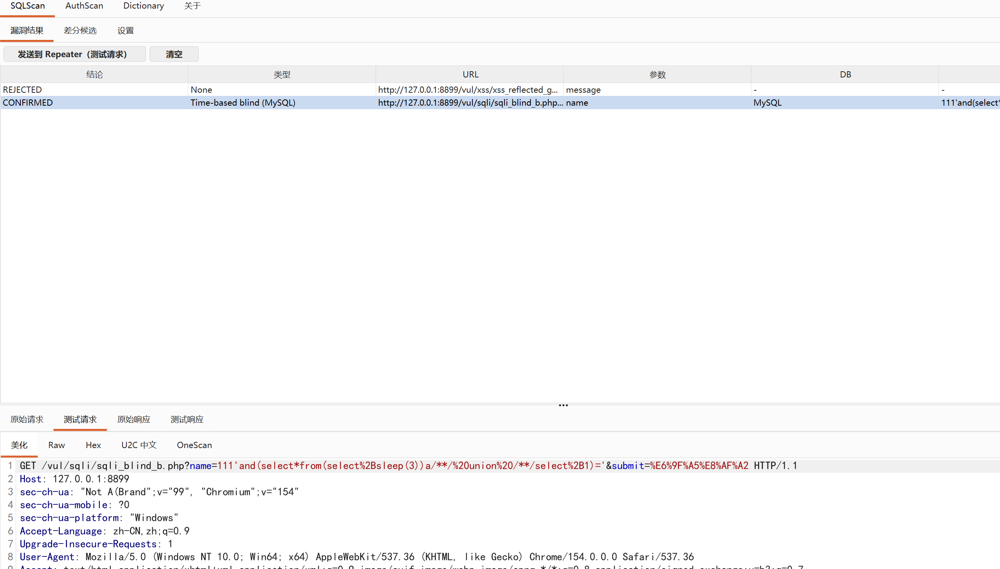
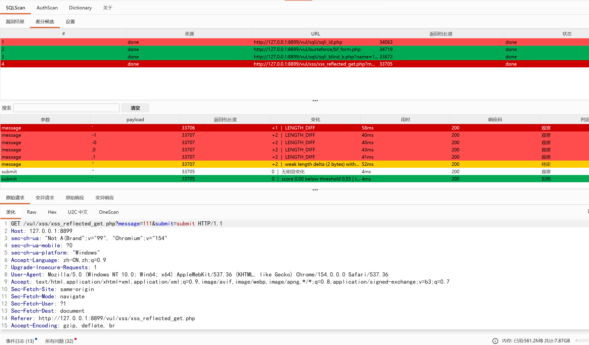
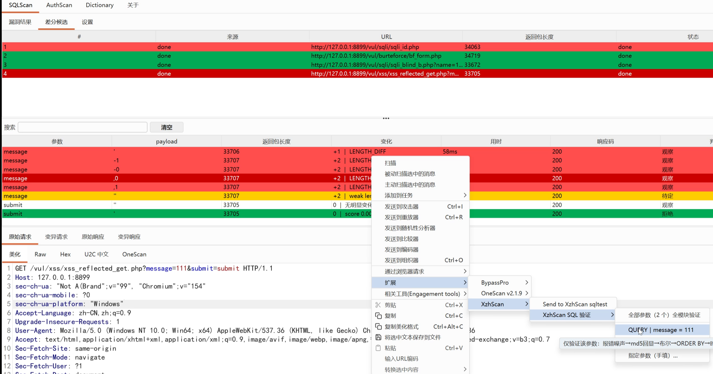
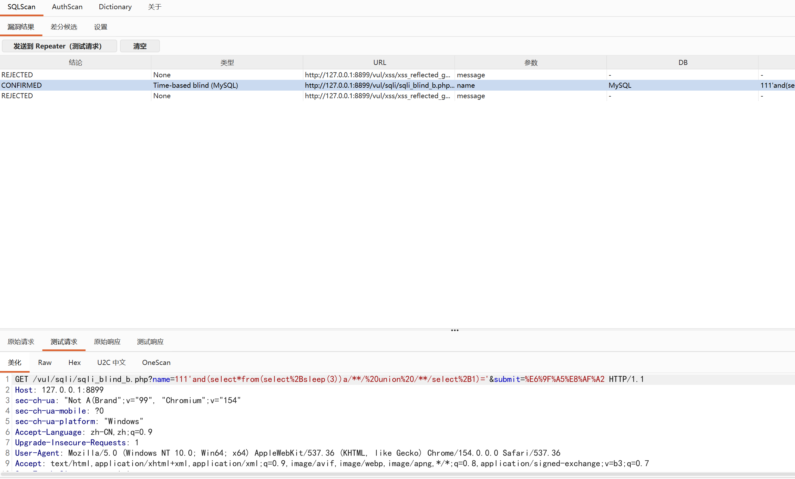
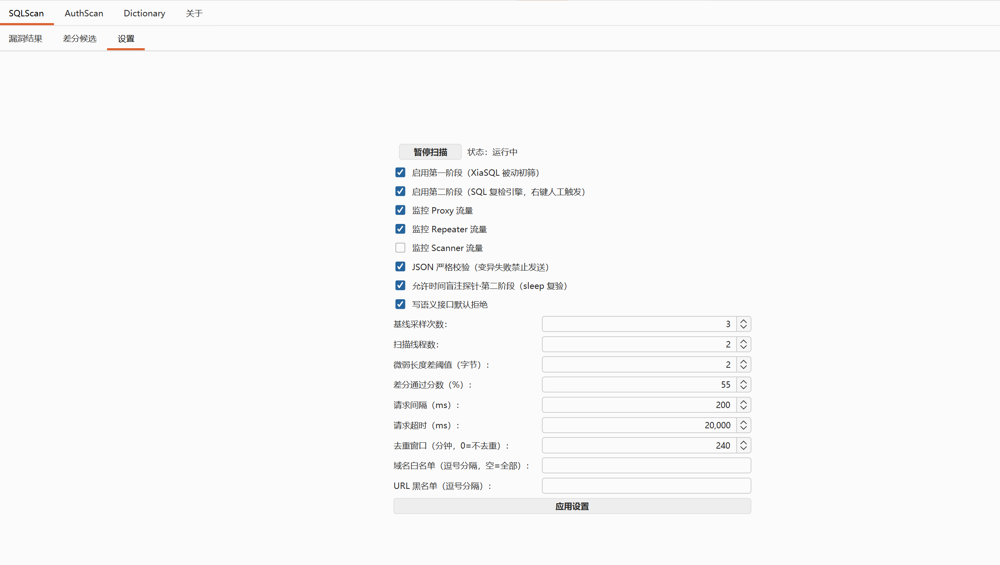
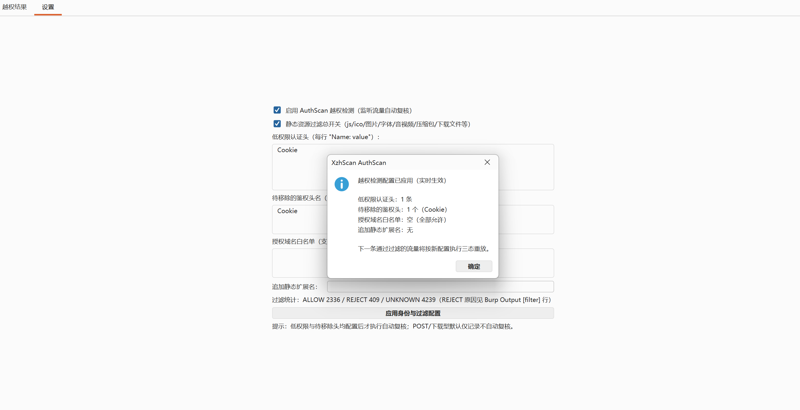
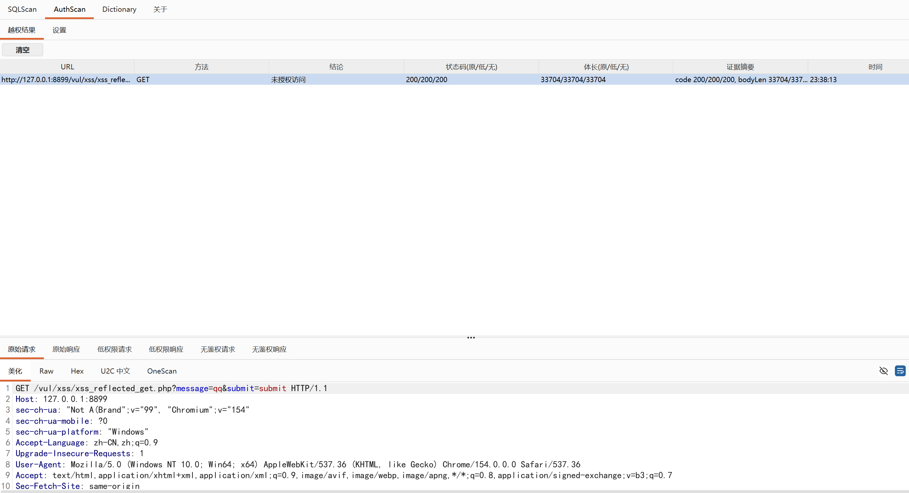
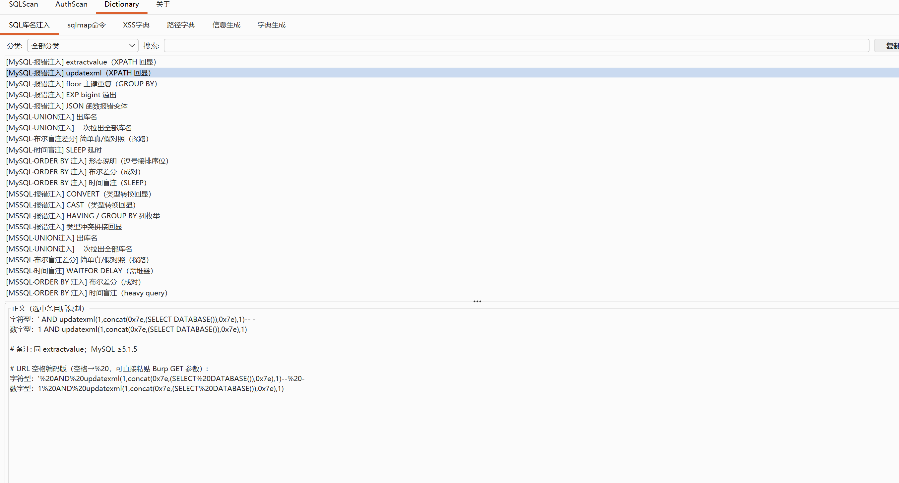
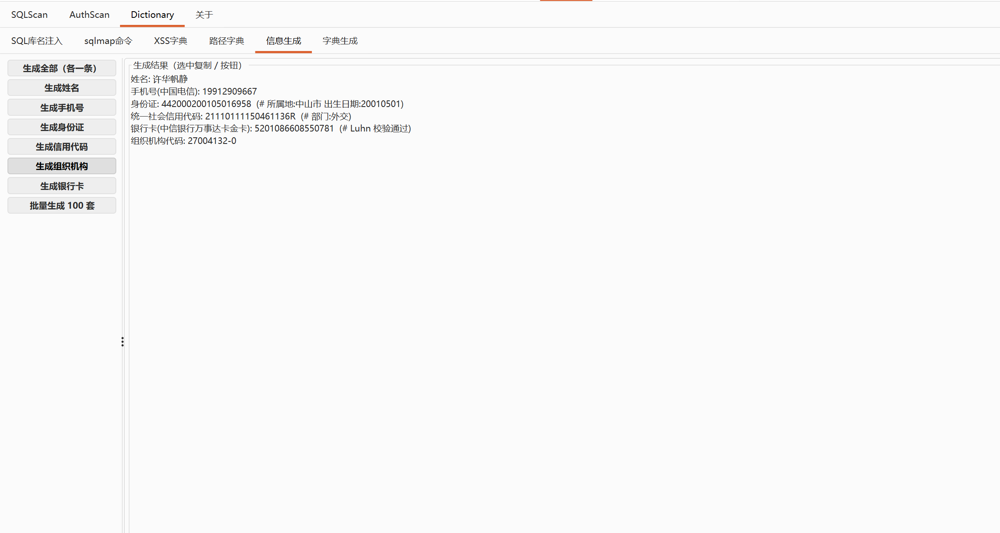
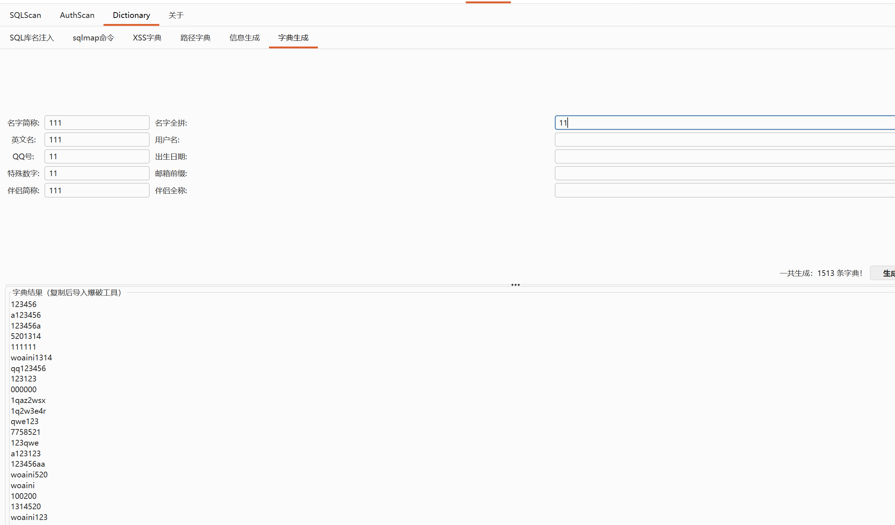

# XzhScan

**Burp Suite 综合检测插件 —— SQL 注入 / 越权检测 / 渗透字典**

独立 Burp Suite 扩展（Montoya API / Java 17），零第三方依赖。以「人工化」为核心理念：
被动只做**低成本差分初筛**，把是否深挖的决定权交给测试者；二阶段验证由右键人工触发，
结果统一回流漏洞结果页。配套内置渗透字典与信息生成器，一个插件覆盖 SQL 注入、
越权检测、资料构造三条高频链路。

> 作者：**Xzh** · QQ：**1421946905**

---

## 目录

- [核心特性](#核心特性)
- [界面展示](#界面展示)
- [安装](#安装)
- [工作流](#工作流)
- [模块说明](#模块说明)
- [参考项目](#参考项目)

---

## 核心特性

| 模块 | 能力 |
|---|---|
| **SQLScan** | XiaSQL 风格被动差分初筛（每个参数 5~7 个探针，只列候选不自动验证）<br>右键人工触发二阶段全模块验证（Mingdong-Pro SQLIScanner 移植，**payload 直接引用 xray 检测集**）<br>**ORDER BY 注入检测**：布尔报错型 + 时间盲注型双路径，逗号排序位子查询 payload，全参数发送不按参数名门槛<br>**命中即停**：时间快探 ≥850ms 立即停止枚举，同模板三级 `sleep(0)→S→S+1` 阶梯定罪；任一模块 CONFIRMED 即短路后续模块<br>差分候选页 XiaSQL 主从表 + 三色高亮（红=有变化 / 黄=待定 / 绿=拒绝）<br>漏洞结果页四态结论 + 四原生编辑器证据对比 + 一键发送 Repeater |
| **AuthScan** | 三态重放越权检测（原始 / 低权限 / 无鉴权），请求头热更新实时生效<br>**改进：静态资源不列入检测**——ico / js / css / 图片 / 字体 / 音视频 / 压缩包等 50+ 扩展名自动跳过，不对资源文件做三态重放，大幅降低噪声与无效请求<br>六编辑器对照可视化（原始、低权限、无鉴权 请求响应各一对）<br>授权域名白名单 + 追加扩展名 + 应用成功弹窗摘要 |
| **Dictionary** | SQL 库名注入字典：5 类 DBMS × 5 种注入类型 = 25 细分类，含 URL 空格编码版<br>sqlmap 命令速查（按注入类型 / 出库名链路 / 鉴权 / WAF 绕过 / https 专项）<br>XSS 实战 payload 字典（含无危害验证组）<br>路径字典（Linux + Windows 双平台）<br>信息生成（姓名/手机号/身份证/信用代码/组织机构/银行卡，校验位算法生成）<br>弱口令字典生成（十关键字段模板组合 + top100） |
| **U2C 中文查看** | 全局消息编辑器附加页签，一键解码 Unicode / 中文编码报文 |

**设计原则**

- **被动不打扰**：被动阶段只发差分探针（引号对 + 数字算术），绝不自动进二阶段
- **人工决定深挖**：右键选参数 / 全参数验证，安全闸二次复核后才发包
- **安全围栏**：静态资源 / 写语义接口 / 重复请求自动拦截，暂停 = 完全离岗（不发包也不入库）
- **证据可回溯**：每条结论绑定原始/变异请求响应，四编辑器直接对比

---

## 界面展示

### SQLScan · 漏洞结果

二阶段验证结论统一落表：结论（CONFIRMED/REJECTED）、注入类型、URL、参数、DB、payload 全量留痕；
底部四编辑器（原始请求 / 测试请求 / 原始响应 / 测试响应）直接核对证据，可一键发送 Repeater 复现。



### SQLScan · 差分候选（XiaSQL 主从表）

主表按请求聚合（URL 行三色高亮：红=有响应变化 / 黄=待定需人工复核 / 绿=拒绝），
选中后从表展示该请求每条探针的原始观察（参数 / payload / 返回包长度 / 变化 / 用时 / 响应码 / 判定）；
底部原始/变异请求响应四编辑器，滚动即可核对每个探针。



### SQLScan · 右键指定参数进入二阶段

从差分候选里挑中可疑参数后，右键 → 扩展 → XzhScan → **「XzhScan SQL 验证」**，三级菜单任你选：

- **全部参数（N 个）全模块验证** —— 整包所有参数跑全模块序列
- **单个参数**（如 `QUERY | message = 111`）—— 只验证你选中的这个参数，
  悬浮提示即展示该参数的验证链路：报错噪声 → md5 回显 → 布尔 → ORDER BY → 时间盲注
- **指定参数（手填）…** —— 手填参数名 / JSON 路径（`$.user.name`）精确验证

人工决定挖哪个参数，插件只对选中的参数发包。



### SQLScan · 二阶段扫描落库

每次右键人工验证的结论都**原样落库**，不做美化：

- **CONFIRMED / Time-based blind (MySQL)** —— 命中时间盲注，注入类型、DB 家族、payload 全部记录；
  同页 **REJECTED / None** 是验证未成立的参数，结论对比一目了然
- **测试请求**编辑器展示实际发出的变异请求——图中 `name=111' and (select*from(select+sleep(3))a)/** union **/select+1)='`
  即 xray 检测集的原生 payload，发出前经 AST 级构造校验，可直接发送 Repeater 复现
- 每条结论绑定原始/测试 请求响应四份证据，溯源不靠记忆



### SQLScan · 设置

全部行为可调，改完点「应用设置」即时生效：

- **暂停/恢复扫描** —— 暂停 = 完全离岗：不发包、不入库，恢复后流量正常处理
- **阶段开关** —— 启用第一阶段（XiaSQL 被动初筛）/ 启用第二阶段（SQL 复检引擎，右键人工触发）
- **流量来源** —— 监控 Proxy / Repeater / Scanner 三路独立开关
- **安全闸** —— JSON 严格校验（变异失败禁止发送）、写语义接口默认拒绝、
  允许时间盲注探针·第二阶段（sleep 复验总闸）
- **差分调优** —— 基线采样次数、扫描线程数、微弱长度差阈值（字节）、差分通过分数（%）、
  请求间隔 / 超时、去重窗口（分钟）
- **范围控制** —— 域名白名单（空=全部）、URL 黑名单



### AuthScan · 越权检测设置

低权限认证头 / 待移除鉴权头 / 授权域名白名单 / 追加静态扩展名配置；应用后弹窗确认生效摘要，
配置热更新实时生效（下一条流量即按新配置三态重放）。

**改进点：静态资源不列入检测**——ico / js / css / 图片 / 字体 / 音视频 / 压缩包等
50+ 扩展名默认不进入越权检测队列（支持追加自定义扩展名）。不对前端资源文件做三态重放，
避免大量无意义的重复请求与误报噪声；过滤统计栏实时显示 ALLOW / REJECT / UNKNOWN 计数。



### AuthScan · 越权结果

三态对照结论（未授权访问 / 越权访问等）落表：状态码、体长按（原/低/无）三态并列展示；
底部六编辑器页签（原始、低权限、无鉴权 请求响应各一对），证据链完整可见。



### Dictionary · SQL 库名注入

25 个细分类（如「MySQL·报错注入」「MSSQL·ORDER BY 注入」）：每条 payload 标注**字符型/数字型**双形态，
详情区自动附 **URL 空格编码版**（空格→%20，直接粘贴 Burp GET 参数不被截断）。



### Dictionary · 信息生成

随机姓名 / 手机号（三大运营商号段）/ 18 位身份证（GB 11643-1999 校验）/ 统一社会信用代码（GB 32129 校验）/
组织机构代码 / 银行卡（Luhn 校验）——注册资料一键批量生成。



### Dictionary · 字典生成

输入名字简称 / 全拼 / 英文名 / 用户名 / QQ / 出生日期 / 特殊数字 / 邮箱前缀 / 伴侣名等关键字段，
按模板组组合展开弱口令字典（含 top100），实时计数，一键复制导入爆破工具。



---

## 安装

1. Burp Suite ≥ 2023.10（Montoya API）。
2. 下载 [XzhScan.jar](https://github.com/Xzhgood/XzhScan/releases/latest/download/XzhScan.jar)
   → `Extensions → Add → Extension Type: Java` 选择该 jar。
3. 无需安装任何外部依赖（XiaSQL / Mingdong-Pro / sqlmap 均只作参考，无运行时依赖）。

自行构建（JDK 17+）：

```bash
bash build.sh    # Git Bash（推荐）
# 或手动：javac -cp lib/montoya-api.jar -d build/classes $(find src -name '*.java')
```

构建脚本顺序：编译 → 打包 `build/XzhScan.jar` → 编译并运行全量自动化测试
（29 套件 / 1300+ 断言，任何失败即构建失败）。

---

## 工作流

```
流量(Proxy / Repeater / Scanner / 右键)
  │
  ├─► 被动差分初筛（XiaSQL 纯差分，只列候选）
  │     └─► 差分候选页（主从表 + 三色高亮）── 人工判断 ──┐
  │                                                      │
  └─► 右键「XzhScan SQL 验证」◄──────────────────────────┘
        ├─ 全部参数验证（全模块序列）
        ├─ 逐参数选择
        └─ 手填参数名 / JSON 路径
              │
              └─► 二阶段全模块（报错→布尔→ORDER BY→时间）→ 漏洞结果页四态
                    └─ 命中即停：CONFIRMED 短路后续模块 / 时间快探 ≥850ms 停枚举
```

1. **被动看差分**：浏览目标时插件自动对每个参数发引号对 / 数字算术探针，差分候选页实时列出
2. **人工挑参数**：主表红/黄高亮提示可疑请求，点开从表看每条探针的原始响应差异
3. **右键深挖**：对可疑参数右键「XzhScan SQL 验证」，插件按 xray 检测集全模块序列验证；
   **扫出来就停**——任一模块 CONFIRMED 立即短路，时间枚举快探命中 >850ms 立即停止，不浪费请求
4. **结果入库**：CONFIRMED 结论弹 Burp 通知，漏洞结果页可发送 Repeater 复现

---

## 模块说明

### SQLScan 二阶段全模块序列

右键人工验证时按 Mingdong-Pro SQLIScanner 原版顺序执行，**时间枚举 payload 直接引用 xray
检测集**（`XRAY_ORDER_PROBES` / `XRAY_NUMERIC_PROBES`，与 Mingdong-Pro v12 字节码逐条对齐）；
**任一模块 CONFIRMED 即短路**后续模块，时间枚举**命中即停**：

1. `heuristic` —— 引号噪声探测（弱指纹降级 SUSPECTED）
2. `errConfirm` —— extractvalue / HashBytes md5 回显确认
3. `castBool` —— cast(md5()) 布尔对照
4. `boolPair` —— 真假布尔对（带 5xx 安全门与第三边校验）
5. `orderBoolError` —— **ORDER BY 布尔报错检测**（逗号排序位子查询，全参数发送）
6. `timeBased` —— QUICK → **XRAY_ORDER（ORDER BY 时间注入检测）** → XRAY_NUMERIC 枚举：
   快探响应 **≥850ms 即判定命中并停止枚举**（不再试其他 DBMS 家族），命中模板进入
   三级 `sleep(0)→S→S+1` 阶梯定罪（相对差分：`tS−t0 ≥ S×750ms` 且 `tS1−tS ≥ 500ms`）

### ORDER BY 注入检测

ORDER BY 位不能接 AND/OR，需用**前导逗号 + 子查询**作为第二排序位。插件两条路径覆盖：

- **时间型**：xray `XRAY_ORDER_PROBES`（5 条：`,(select*from(select+sleep(S))a)`、
  `,(select 1 from pg_sleep(S))`、`CASE WHEN 1=2 THEN 1 ELSE SLEEP(S) END`、`IF(1=2,1,SLEEP(S))` 及
  `union/**/select+1` 变体）——命中后用同模板三级阶梯定罪
- **布尔报错型**：`orderBoolError` 模块（`,` + `CASE WHEN 1=1 THEN 1 ELSE 1*(SELECT 1 UNION ALL SELECT 2) END`
  真假成对，假分支触发子查询多行报错）

两条路径均**全参数发送、不按参数名门槛**——参数名不叫 order/sort、但值实际拼进 ORDER BY 位时同样覆盖；
拼在 WHERE/数字位时语法错误不命中，不产生误报，代价仅为每参数数个额外请求。

### 安全围栏

- 静态资源（48+ 后缀）不进列表；重复请求去重；无参数请求不入表
- 写语义接口（delete/update/pay/upload 等路径词）默认拒绝
- 暂停 = 完全离岗：不发包、不入库
- 有界队列（200）+ 限速 + 单次超时预算（时间探针自动加大）

### 配置与兼容

- 配置持久化于 Burp extensionData，三级键回退（xzhscan → xzhsql → dualsql）
- configVersion 版本迁移链：旧配置自动升级，历史偏好不被覆盖
- 零第三方依赖，jar 可直接加载

---

## 参考项目

本插件的设计吸取了以下开源项目的思想与资产（均只作参考，无运行时依赖）：

- [smxiazi/xia_sql](https://github.com/smxiazi/xia_sql) —— XiaSQL 瞎注：被动差分检测思想与参数变异策略
- [smxiazi/xia_Yue](https://github.com/smxiazi/xia_Yue) —— xia_Yue：越权检测三态重放思路
- [smxiazi/xia_Liao](https://github.com/smxiazi/xia_Liao) —— 瞎料：信息生成与弱口令字典算法
- [chaitin/xray](https://github.com/chaitin/xray) —— xray：二阶段时间盲注 / ORDER BY 注入检测集
  （`XRAY_ORDER_PROBES` / `XRAY_NUMERIC_PROBES`）payload 来源
- gatherBurp Perm —— 越权检测模块基础
- Mingdong-Pro SQLIScanner —— 二阶段全模块验证序列
- sqlmap —— SQL 库名注入语句与 sqlmap 命令口径

---

## 联系作者

- **Xzh**
- QQ：**1421946905**

> 本插件仅限**授权测试**使用。请勿用于未授权的目标。
